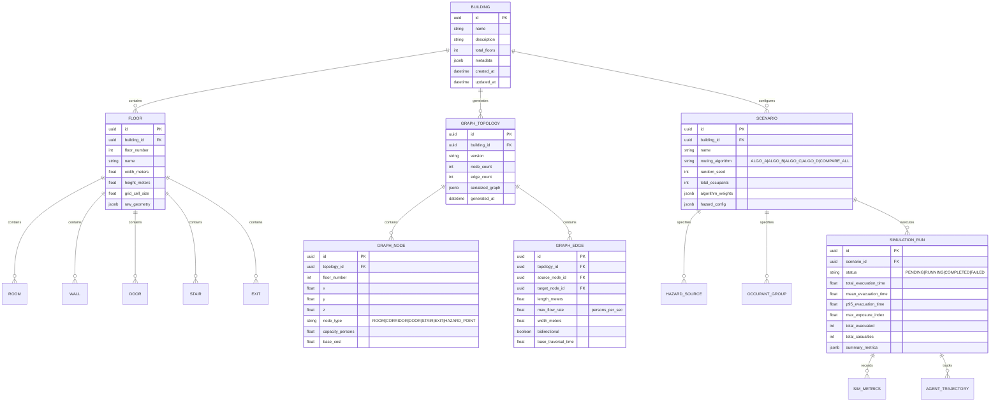

# System Architecture & Technical Specifications

**Project:** Intelligent Emergency Evacuation Digital Twin  
**Document Version:** 1.0.0  
**Status:** Approved Architectural Blueprint  

---

## 1. High-Level Architecture Overview

The system is structured as a **Modular Monolith** with clear boundary separation between the Digital Twin Command Center (Frontend), the Core API & Domain Services, and the High-Performance Simulation & Graph Engine.

```
┌────────────────────────────────────────────────────────────────────────────────────────┐
│                              FRONTEND (Next.js 14+ / React)                            │
│ ┌─────────────────────────┐ ┌──────────────────────────┐ ┌───────────────────────────┐ │
│ │ Building & Graph Editor │ │   2D/3D Live Twin HUD    │ │ Race & Analytics Dashboard│ │
│ │  (Canvas / Layer Mgmt)  │ │ (Canvas 2D + R3F ThreeJS)│ │ (Recharts, Replay Scrubber)│ │
│ └────────────┬────────────┘ └────────────┬─────────────┘ └─────────────┬─────────────┘ │
│              │                           │                             │               │
│              └───────────────────┐       │       ┌─────────────────────┘               │
│                                  ▼       ▼       ▼                                     │
│                        [Zustand Stores: Editor, Sim, Telemetry]                        │
└───────────────────────────────────┬──────────────▲─────────────────────────────────────┘
                                    │ REST         │ WebSocket / SSE Telemetry
                                    ▼              │ (Delta compressed frames)
┌──────────────────────────────────────────────────┴─────────────────────────────────────┐
│                           BACKEND & API LAYER (FastAPI / Python)                       │
│ ┌────────────────────────────────────────────────────────────────────────────────────┐ │
│ │ FastAPI Routers: /buildings, /scenarios, /simulations, /routing, /analytics        │ │
│ └───────────────────────────────────────┬────────────────────────────────────────────┘ │
│                                         │                                              │
│ ┌───────────────────────────────────────┴────────────────────────────────────────────┐ │
│ │ DOMAIN SERVICES: BuildingService, ScenarioService, ExperimentService, SimService   │ │
│ └───────────────────────────────────────┬────────────────────────────────────────────┘ │
│                                         │                                              │
│ ┌───────────────────────────────────────▼────────────────────────────────────────────┐ │
│ │                   SIMULATION ENGINE (Single Source of Truth)                       │ │
│ │ ┌───────────────────┐ ┌───────────────────┐ ┌───────────────────┐ ┌──────────────┐ │ │
│ │ │  Graph Builder &  │ │ Hazard Engine     │ │ Heterogeneous     │ │ Discrete-    │ │ │
│ │ │  Spatial Index    │ │ (Fire/Smoke/FDS)  │ │ Occupant Model    │ │ Event Sim    │ │ │
│ │ └─────────┬─────────┘ └─────────┬─────────┘ └─────────┬─────────┘ └──────┬───────┘ │ │
│ │           │                     │                     │                  │         │ │
│ │           └─────────────────────┼─────────────────────┴──────────────────┘         │ │
│ │                                 ▼                                                  │ │
│ │                  ROUTING & PREDICTION ENGINE (Algorithms A, B, C, D)               │ │
│ │                  - Multi-Horizon Queue Estimator (t+10s, t+20s, ...)               │ │
│ │                  - Selective Threshold-Based Dynamic Rerouter                      │ │
│ │                  - Explainability & Decision Telemetry Generator                   │ │
│ └────────────────────────────────────────────────────────────────────────────────────┘ │
│                                         │                                              │
│ ┌───────────────────────────────────────▼────────────────────────────────────────────┐ │
│ │ DATA PERSISTENCE: SQLAlchemy 2.0 Async + PostgreSQL (SQLite for local/test)        │ │
│ └────────────────────────────────────────────────────────────────────────────────────┘ │
└────────────────────────────────────────────────────────────────────────────────────────┘
```

---

## 2. Domain Models & Database ERD



---

## 3. Mathematical Formulations of Routing Strategies

### 3.1 Algorithm A: Baseline Shortest-Path A*
Standard shortest-distance A* routing optimizing geometric distance to nearest open exit:
$$f_A(u) = g(u) + h(u)$$
- $g(u) = \sum_{e \in \text{path}(s, u)} d(e)$ (accumulated Euclidean distance)
- $h(u) = \min_{x \in \text{Exits}} \| u - x \|_2$ (admissible Euclidean distance heuristic to nearest exit)

### 3.2 Algorithm B: Safety-Aware A*
Augments path cost with local environmental hazard intensity:
$$f_B(u) = g_B(u) + h(u)$$
$$g_B(u) = \sum_{e=(v, w) \in \text{path}} \left[ d(e) + w_{\text{hazard}} \cdot H(w) \right]$$
where $H(w)$ is the aggregate hazard penalty at node $w$:
$$H(w) = k_{\text{fire}} \cdot I_{\text{fire}}(w) + k_{\text{smoke}} \cdot S_{\text{smoke}}(w) + k_{\text{temp}} \cdot \max(0, T(w) - T_{\text{threshold}})$$
If $H(w) \ge H_{\text{fatal}}$, the node is marked impassable ($\text{cost} = \infty$).

### 3.3 Algorithm C: Real-Time Load-Aware A*
Penalizes edges leading to congested doorways and exits based on instantaneous queue depths:
$$g_C(u) = \sum_{e=(v, w) \in \text{path}} \left[ \frac{d(e)}{v_{\text{base}}} + \frac{Q_{\text{node}}(w, t)}{C_{\text{flow}}(w)} \right] + \frac{Q_{\text{exit}}(\text{Exit}_w, t)}{R_{\text{discharge}}(\text{Exit}_w)}$$
- $Q_{\text{node}}(w, t)$: Number of agents currently inside node/corridor $w$.
- $C_{\text{flow}}(w)$: Max flow capacity of passage $w$ (persons/sec).
- $Q_{\text{exit}}(x, t)$: Current queue length at exit $x$.
- $R_{\text{discharge}}(x)$: Exit door evacuation throughput (persons/sec).

### 3.4 Algorithm D: Dynamic Safety-Aware + Predictive Load-Aware Rerouting (Proposed System)
Integrates distance, base travel time, dynamic hazard growth, current congestion, **predictive exit queue depth at arrival time**, and cumulative hazardous exposure:

$$\text{Cost}(e = (v, w), t_{\text{arr}}) = \alpha \cdot d(e) + \beta \cdot \frac{d(e)}{v_{\text{agent}}} + \gamma \cdot H(w, t_{\text{arr}}) + \delta \cdot \frac{Q(w, t_{\text{arr}})}{C(w)} + \epsilon \cdot \hat{Q}_{\text{exit}}(x, t_{\text{arr}} + \tau_{\text{remain}}) + \zeta \cdot E_{\text{accum}}(v, w)$$

#### Predictive Multi-Horizon Queue Estimator:
The queue length at exit $x$ when the agent arrives at $t_{\text{target}} = t + \tau_{\text{remain}}$ is estimated deterministically from incoming agent ETA vectors:
$$\hat{Q}_x(t_{\text{target}}) = \max\left(0, Q_x(t) + \sum_{a \in \text{Agents}} \mathbb{I}\left( \text{Dest}(a)=x \land \text{ETA}(a) \le t_{\text{target}} \right) - R_x \cdot (t_{\text{target}} - t)\right)$$

#### Selective Dynamic Rerouting Protocol:
Agents do not recalculate paths every tick (preventing $O(N \cdot |V| \log |V|)$ CPU bottleneck). Instead, selective recalculation triggers only if:
1. An edge along the planned path becomes blocked or exceeds hazard safety threshold ($H(w) > \theta_{\text{hazard}}$).
2. The predicted exit delay exceeds the original ETA by a ratio $\Delta Q_{\text{exit}} / Q_{\text{original}} > \theta_{\text{congestion}}$ (e.g., $+35\%$).
3. Rerouting hysteresis timer $\Delta t_{\text{reroute}} \ge t_{\text{cooldown}}$ has elapsed to prevent thrashing between two equidistant exits.

---

## 4. API Contracts & Endpoints (v1)

### 4.1 Buildings & Floorplans
- `GET /api/v1/buildings` — List all buildings.
- `POST /api/v1/buildings` — Create building with floor configurations.
- `GET /api/v1/buildings/{id}` — Get building details with all floors and elements.
- `PUT /api/v1/buildings/{id}` — Update building metadata.
- `POST /api/v1/buildings/{id}/floors/{floor_id}/elements` — Batch save rooms, walls, doors, stairs, exits.
- `POST /api/v1/buildings/{id}/generate-graph` — Generate and validate navigation graph from floorplan.
- `GET /api/v1/buildings/{id}/graph` — Get serialized topological graph (nodes, edges, capacities).

### 4.2 Scenarios & Hazards
- `POST /api/v1/scenarios` — Create simulation scenario (hazard origin, population size, demographics, algorithm parameters).
- `GET /api/v1/scenarios/{id}` — Retrieve scenario details.
- `POST /api/v1/scenarios/{id}/upload-fds` — Upload and sanitize external FDS hazard profile.

### 4.3 Simulation Execution & Telemetry
- `POST /api/v1/simulations/run` — Start headless or stepped simulation session.
- `GET /api/v1/simulations/{id}/state` — Fetch current tick state snapshot.
- `POST /api/v1/simulations/{id}/control` — Control execution (play, pause, step, set_speed, reset).
- `WS /api/v1/ws/simulation/{id}` — WebSocket stream for real-time delta-compressed telemetry frames.

### 4.4 Analytics & Benchmarks
- `POST /api/v1/analytics/race` — Execute identical scenario across all 4 algorithms (A, B, C, D) and return comparative distributions.
- `GET /api/v1/analytics/{simulation_id}/metrics` — Export TET, P95, mean travel time, bottleneck metrics, and agent trajectory logs.

---

## 5. Telemetry & State Synchronization Model

To ensure high frame rates (60 FPS frontend rendering) while simulating up to 1,000 agents:
- **Server Tick Rate:** Configurable (10 Hz – 50 Hz discrete simulation steps).
- **Delta Compression:** The WebSocket transmits full state on connection / keyframe, and only delta changes (agent positions $[x, y, z, \text{speed}, \text{state}]$, hazard intensities, exit queue counts) on intermediate ticks.
- **Unified Dual-Viewport:** The 2D HTML5 Canvas and 3D React Three Fiber (R3F) scene subscribe to the identical `simStore` Zustand slice.
